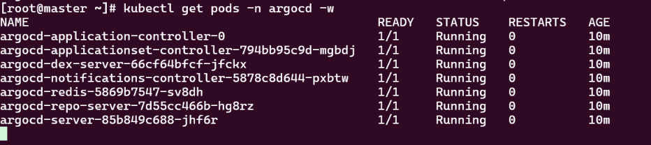
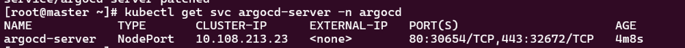
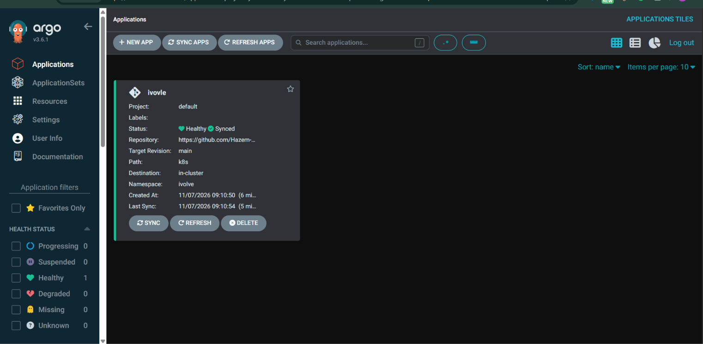
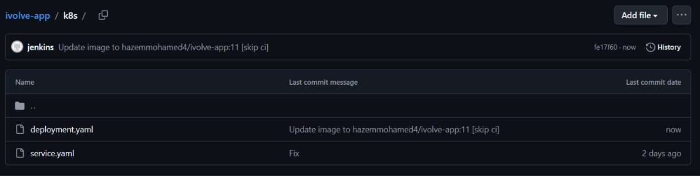
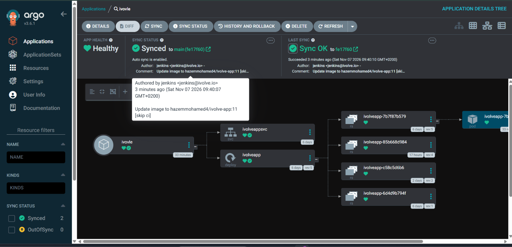

# Lab 23: Implementing a GitOps Workflow with Jenkins and Argo CD

## Objective

Move the deployment step of the CI/CD pipeline from `kubectl apply` (push model) to **GitOps** (pull model):

- Jenkins builds, scans and pushes the image, then **commits the updated manifest to GitHub**.
- **Argo CD** watches the repository and automatically syncs the cluster to match Git.

```
Jenkins pipeline                                   Kubernetes cluster
 ├─ Build App (unit tests)                          ┌───────────────────┐
 ├─ Build Image + Trivy scan + push                 │  Argo CD          │
 └─ DeployOnK8s: sed image tag ─► git push ─► GitHub ─► (auto-sync) ─► ivolve namespace
                                      (k8s/deployment.yaml)   └───────────────────┘
```

## Environment

| Item               | Value                                                       |
| ------------------ | ----------------------------------------------------------- |
| Cluster            | kubeadm cluster (1 master + 1 worker)                       |
| Argo CD            | v3.6.1, namespace `argocd`                                  |
| Git repository     | `https://github.com/Hazem-Mohamed8/ivolve-app` (public)     |
| Manifest directory | `k8s/` (`deployment.yaml`, `service.yaml`)                  |
| Target namespace   | `ivolve`                                                    |
| Application name   | `ivovle`                                                    |
| Jenkins pipeline   | `Jenkinsfile.lab22` with shared library `ivolve-shared-lib` |

---

## Step 1: Install Argo CD

```bash
kubectl create namespace argocd
kubectl apply -n argocd --server-side -f https://raw.githubusercontent.com/argoproj/argo-cd/stable/manifests/install.yaml
kubectl get pods -n argocd -w
```

All Argo CD components reach `Running`:



> Note: the worker node must not carry a taint that blocks the Argo CD pods (the `workload=ivolveApp:NoSchedule` taint from Lab 10 had to be removed), otherwise they stay `Pending`.

## Step 2: Access the Argo CD UI and log in

Expose the server with a NodePort:

```bash
kubectl patch svc argocd-server -n argocd -p '{"spec":{"type":"NodePort"}}'
kubectl get svc argocd-server -n argocd
```



HTTPS is mapped to NodePort `32672`. The port was opened in the worker's AWS Security Group, and the UI is reached at `https://<worker-public-ip>:32672`.

Initial admin password:

```bash
kubectl -n argocd get secret argocd-initial-admin-secret -o jsonpath="{.data.password}" | base64 -d; echo
```

Login with user `admin` and the password above.

## Step 3: Connect Argo CD to the GitHub repository

The repository is **public**, so no credentials or "Connect Repo" step are needed. The repo URL is referenced directly in the Application. (For a private repo: Settings → Repositories → Connect Repo → HTTPS with username + personal access token.)

## Step 4–6: Create the Application `ivovle` with automatic sync

`ivovle-app.yaml` (applied on the master, **not** stored inside `k8s/`):

```yaml
apiVersion: argoproj.io/v1alpha1
kind: Application
metadata:
  name: ivovle
  namespace: argocd
spec:
  project: default
  source:
    repoURL: https://github.com/Hazem-Mohamed8/ivolve-app.git
    targetRevision: main
    path: k8s
  destination:
    server: https://kubernetes.default.svc
    namespace: ivolve
  syncPolicy:
    automated:
      prune: true
      selfHeal: true
    syncOptions:
      - CreateNamespace=true
```

```bash
kubectl apply -f ivovle-app.yaml
kubectl get applications -n argocd
```



## Step 7: Modify the `DeployOnK8s` shared library

Instead of `kubectl apply` + `rollout status`, the library now edits the image tag, commits and pushes to GitHub. Argo CD performs the deployment.

`vars/DeployOnK8s.groovy`:

```groovy
def call(String imageName, String imageTag,
         String deploymentFile = "k8s/deployment.yaml",
         String repoUrl = "github.com/Hazem-Mohamed8/ivolve-app.git",
         String branch = "main",
         String gitCredsId = "github-creds") {
    echo "DeployOnK8s: ${imageName}:${imageTag} -> push to ${repoUrl} (${branch})"

    // only the application image is replaced, the mysql init container image is untouched
    sh "sed -i \"s|image: ${imageName}:.*|image: ${imageName}:${imageTag}|\" ${deploymentFile}"
    sh "grep -n \"image:\" ${deploymentFile}"

    withCredentials([usernamePassword(credentialsId: gitCredsId,
                                      usernameVariable: "GIT_USER",
                                      passwordVariable: "GIT_TOKEN")]) {
        sh """
            git config user.email "jenkins@ivolve.io"
            git config user.name "jenkins"
            git add ${deploymentFile}
            git commit -m "Update image to ${imageName}:${imageTag} [skip ci]" || { echo "No changes to commit"; exit 0; }
            git push https://\${GIT_USER}:\${GIT_TOKEN}@${repoUrl} HEAD:${branch}
        """
    }
}
```

## Step 8: Trigger the Jenkins pipeline

Run the pipeline. Stages: Build App → Build Image (scan + push to Docker Hub) → Deploy to Kubernetes (which now pushes to Git). Jenkins pushed a new commit to the repository:



The commit message is `Update image to hazemmohamed4/ivolve-app:11 [skip ci]`, authored by `jenkins` on `k8s/deployment.yaml`.

## Step 9: Confirm Argo CD detects the change and syncs

Argo CD picked up commit `fe17f60` from `main`, auto-synced it, and the new ReplicaSet and pod came up healthy:



Verification commands:

```bash
kubectl get applications -n argocd
kubectl get pods -n ivolve
kubectl get deploy ivolveapp -n ivolve -o jsonpath='{.spec.template.spec.containers[0].image}'; echo
```
