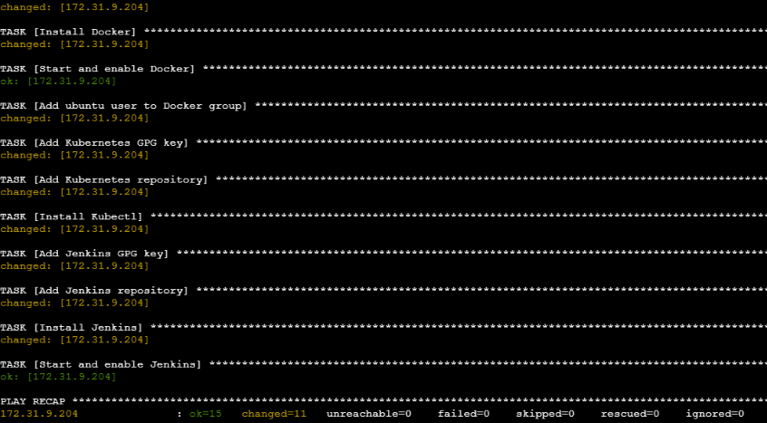

# Lab 25: Automated Configuration Using Ansible Playbooks

## 1) Lab Overview & Objectives

Automates installation of Docker, kubectl and Jenkins on the managed node with one playbook.

- Control Node: ansible-master
- Managed Node: ansible-managed-node (`172.31.9.204`)

Automated tasks:

- Install prerequisites (ca-certificates, curl, gnupg, openjdk-21-jre).
- Configure official repos and GPG keys for Docker, Kubernetes, Jenkins.
- Install Docker CE, start/enable it, add `ubuntu` to the `docker` group.
- Install kubectl.
- Install Jenkins, start/enable the service.

## 2) Files (`ansible/lab25/`)

- `inventory`
- `tools_playbook.yaml`

## 3) Playbook Execution

```bash
ansible-playbook -i inventory tools_playbook.yaml --syntax-check
ansible-playbook -i inventory tools_playbook.yaml
```



## 4) Verification on the Managed Node

```bash
root@ip-172-31-9-204:~# docker --version && kubectl version --client && jenkins --version
Docker version 29.9.3, build 5457199
Client Version: v1.35.10
Kustomize Version: v5.7.1
2.580.2
root@ip-172-31-9-204:~#
```

```bash
root@ip-172-31-9-204:~# curl -s -I http://localhost:8080/login | head -n 1 && groups ubuntu
HTTP/1.1 200 OK
ubuntu : ubuntu adm cdrom sudo dip lxd docker
```
