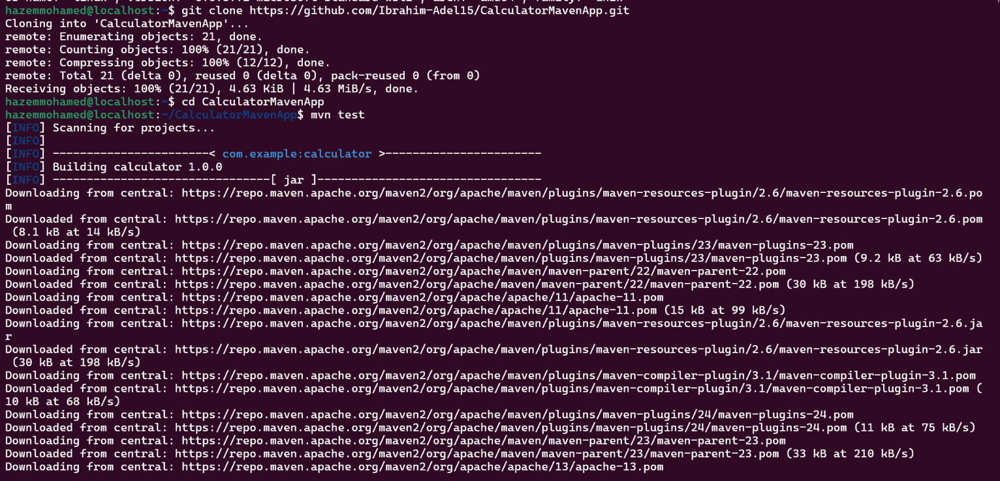
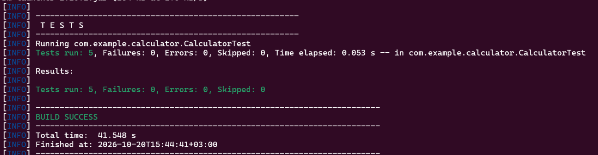
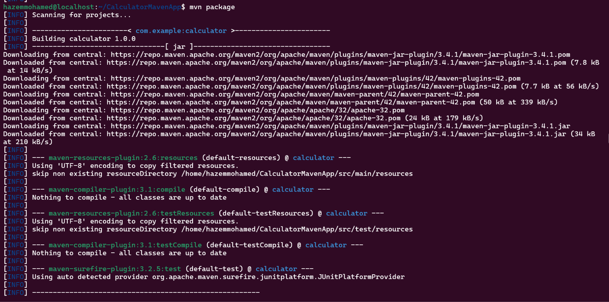
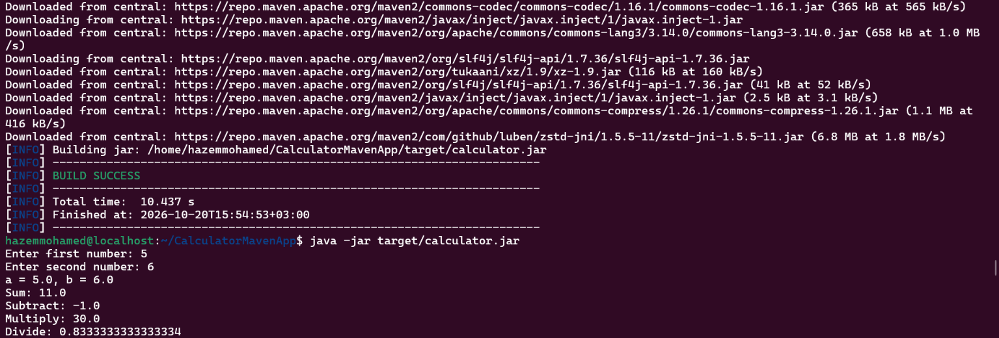
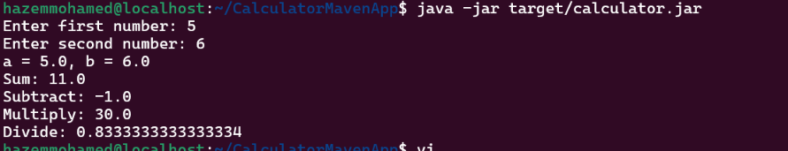

## 1. Install Java and Maven

```bash
sudo apt update && sudo apt install -y openjdk-17-jdk maven
java -version
```
## 2. Clone the source code

```bash
git clone https://github.com/Ibrahim-Adel15/CalculatorMavenApp.git
cd CalculatorMavenApp
```



## 3. Run the unit tests

```bash
mvn test
```

All tests should pass (`BUILD SUCCESS`).



## 4. Build the application

```bash
mvn package
ls target/calculator.jar
```

Maven compiles the code, runs the tests again, and packages the artifact at `target/calculator.jar`.




## 5. Run the application and verify it works

```bash
java -jar target/calculator.jar
```


