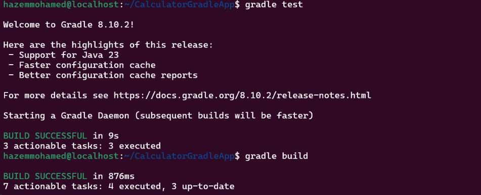
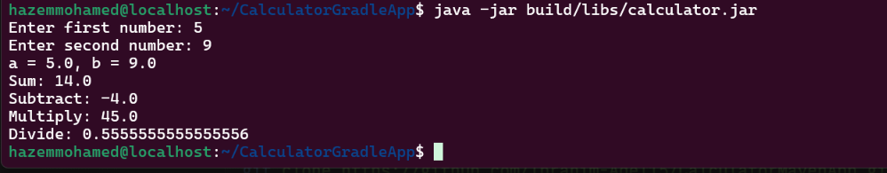

# Lab 2

## 1. Install Gradle

```bash
sudo apt install -y curl zip unzip
curl -s "https://get.sdkman.io" | bash
source "$HOME/.sdkman/bin/sdkman-init.sh"
sdk install gradle 8.10.2
```
## 2. Clone the source code

```bash
git clone https://github.com/Ibrahim-Adel15/CalculatorGradleApp.git
cd CalculatorGradleApp
```

## 3. Run the unit tests

```bash
gradle tes
```



## 4. Build the application

```bash
gradle build
ls build/libs/calculator.jar
```

The artifact is generated at `build/libs/calculator.jar`.


## 5. Run the application and verify it works

```bash
java -jar build/libs/calculator.jar
```



