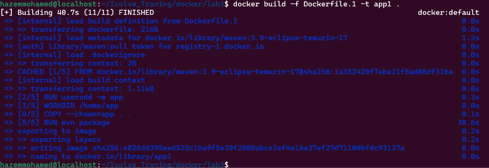
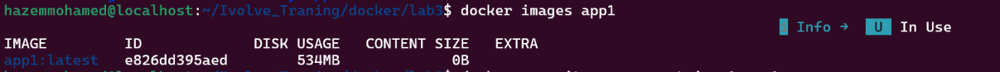
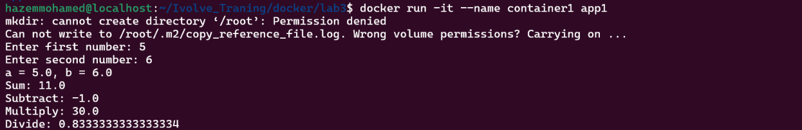
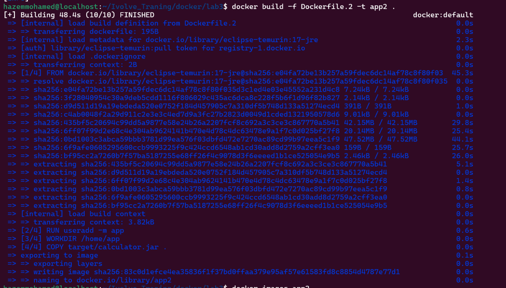
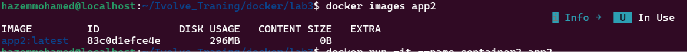
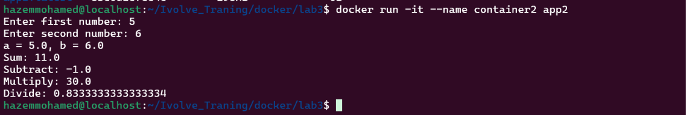

# Lab 3

## Part 1: Build Inside Docker (`Dockerfile.1`)

```dockerfile
FROM maven:3.9-eclipse-temurin-17
RUN useradd -m app
USER app
WORKDIR /home/app
COPY --chown=app . .
RUN mvn package
EXPOSE 8080
CMD ["java", "-jar", "target/calculator.jar"]
```

### Steps

Build the image:

```bash
docker build -f Dockerfile.1 -t app1 .
```



Check the image size:

```bash
docker images app1
```



Run the container and verify the application:

```bash
docker run -it --name container1 app1
```



---

## Part 2: Build Locally (`Dockerfile.2`)

```dockerfile
FROM eclipse-temurin:17-jre
RUN useradd -m app
USER app
WORKDIR /home/app
COPY target/calculator.jar .
EXPOSE 8080
CMD ["java", "-jar", "calculator.jar"]
```

### Steps

Build the application locally:

```bash
mvn package
ls target/calculator.jar
```


Build the image:

```bash
docker build -f Dockerfile.2 -t app2 .
```



Check the image size:

```bash
docker images app2
```



Run the container and verify the application:

```bash
docker run -it --name container2 app2
```



---

## Image Size Comparison

| Image | Approach            | Base image                     | Size   |
| ----- | ------------------- | ------------------------------ | ------ |
| app1  | Build inside Docker | `maven:3.9-eclipse-temurin-17` | 534 MB |
| app2  | Build locally       | `eclipse-temurin:17-jre`       | 296 MB |
