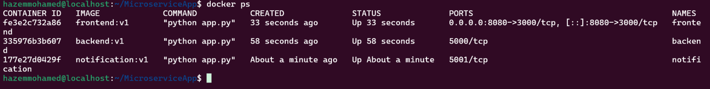
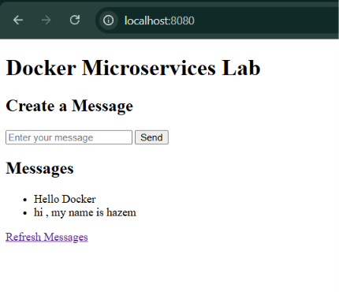

# Lab 7

## Steps

### 1. Clone the application

```bash
git clone https://github.com/Ibrahim-Adel15/MicroserviceApp.git
cd MicroserviceApp
```

### 2. Build the images

```bash
docker build -t frontend:v1  ./frontend
docker build -t backend:v1  ./backend
docker build -t notification:v1 ./notification
```


### 3. Create the networks (separate subnets)

```bash
docker network create --driver bridge --subnet 172.25.0.0/24 frontend-backend
docker network create --driver bridge --subnet 172.26.0.0/24 backend-notification
```

### 4. Create the volumes and host directory

```bash
docker volume create backend-logs
docker volume create notification-logs
mkdir -p $(pwd)/backend-data
```

### 5. Run the notification service

```bash
docker run -d --name notification  --network backend-notification -v notification-logs:/app/logs notification:v1
```

### 6. Run the backend on both networks

```bash
docker run -d --name backend --network backend-notification -e NOTIFICATION_URL=http://notification:5001/notify -v backend-logs:/app/logs -v $(pwd)/backend-data:/app/date backend:v1
docker network connect frontend-backend backend
```

### 7. Run the frontend

```bash
docker run -d --name frontend --network frontend-backend -p 8080:3000 -e BACKEND_URL=http://backend:5000 frontend:v1
```
### Web page screenshot


