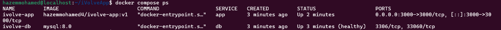
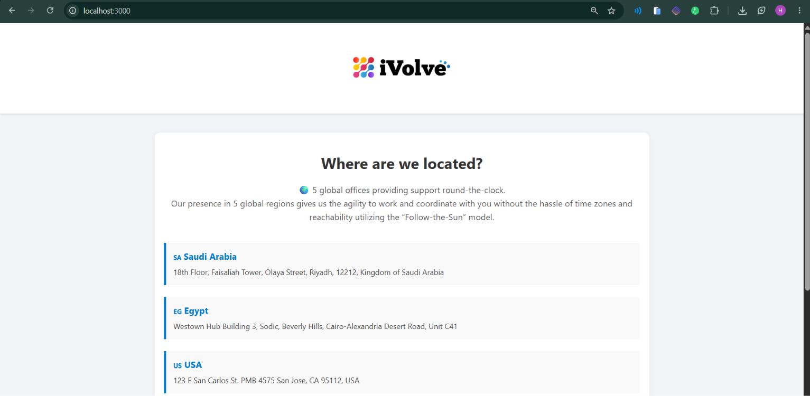
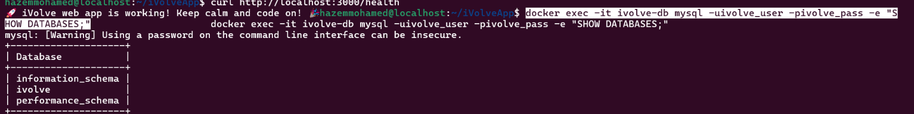
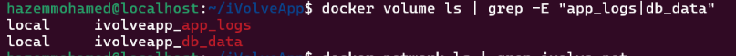
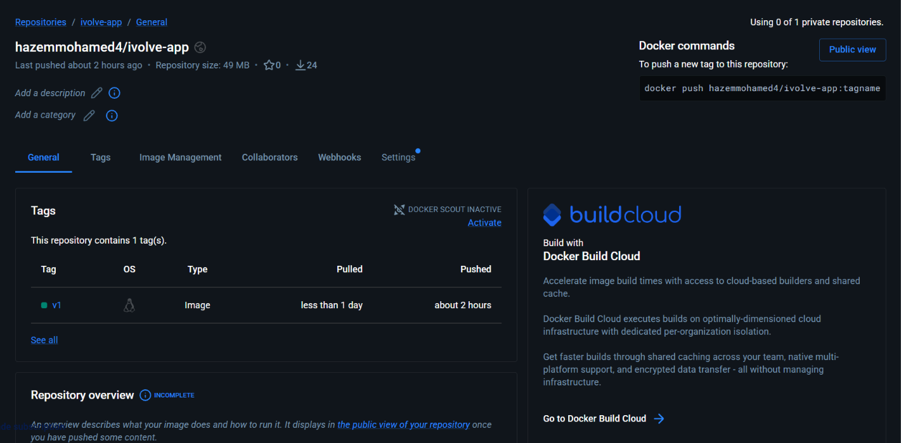

# Lab 8
## Steps

### 1) Get the application source
```bash
git clone https://github.com/Ibrahim-Adel15/iVolveApp.git
cd iVolveApp
```

### 2) Write the Compose file
The application does not create the `ivolve` database by itself. It checks that the database exists and keeps retrying until it does, so MySQL creates it on first start through `MYSQL_DATABASE`. The `db` service has a healthcheck, and the app starts only after MySQL reports healthy.

Create `docker-compose.yml` next to the `Dockerfile`:
```yaml
services:
  app:
    build: .
    image: hazemmohamed4/ivolve-app:v1
    container_name: ivolve-app
    ports:
      - "3000:3000"
    environment:
      DB_HOST: db
      DB_USER: ivolve_user
      DB_PASSWORD: ivolve_pass
    volumes:
      - app_logs:/app/logs
    networks:
      - ivolve-net
    depends_on:
      db:
        condition: service_healthy
    restart: unless-stopped

  db:
    image: mysql:8.0
    container_name: ivolve-db
    environment:
      MYSQL_ROOT_PASSWORD: rootpass
      MYSQL_DATABASE: ivolve
      MYSQL_USER: ivolve_user
      MYSQL_PASSWORD: ivolve_pass
    volumes:
      - db_data:/var/lib/mysql
    networks:
      - ivolve-net
    healthcheck:
      test: ["CMD", "mysqladmin", "ping", "-h", "localhost", "-uroot", "-prootpass"]
      interval: 5s
      timeout: 5s
      retries: 20
    restart: unless-stopped

networks:
  ivolve-net:
    name: ivolve-net

volumes:
  app_logs:
  db_data:
```

### 3) Build the image and start the stack
```bash
docker compose up -d --build
```

### 4) Check the containers
```bash
docker compose ps
```


### 5) Check the application logs
```bash
docker compose logs app
```
The app reports that it connected to MySQL and found the `ivolve` database.

### 6) Test the application
```bash
curl http://localhost:3000/health
```
Then open `http://localhost:3000` in the browser:



### 7) Check the database and the application user
```bash
docker exec -it ivolve-db mysql -uivolve_user -pivolve_pass -e "SHOW DATABASES;"
```


### 8) Check the network and the volumes
```bash
docker network ls | grep ivolve-net
docker volume ls | grep -E "app_logs|db_data"
```


### 9) Push the image to Docker Hub
The `image:` field already names the build `hazemmohamed4/ivolve-app:v1`.
```bash
docker login
docker push hazemmohamed4/ivolve-app:v1
```

