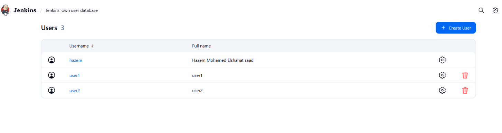
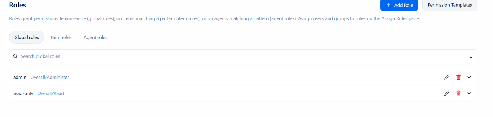
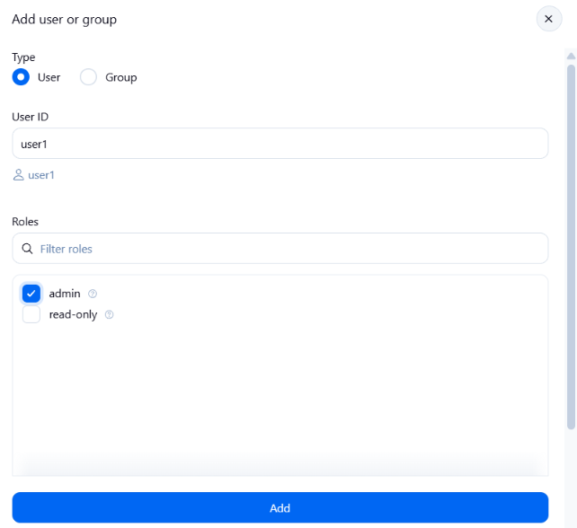
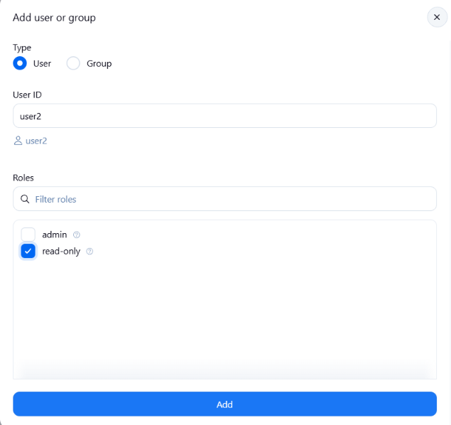

# Lab 20: Role-based Authorization in Jenkins

## Objective

- Create two users in Jenkins: `user1` and `user2`.
- Assign the **admin** role to `user1` (full control).
- Assign a **read-only** role to `user2` (can view, cannot build or configure).

## Steps

### 1. Create the users

`Manage Jenkins` → `Users` → `Create User`:

| Username | Purpose        |
| -------- | -------------- |
| `user1`  | Administrator  |
| `user2`  | Read-only user |

The existing admin user (`hazem`) is kept.

### 3. Enable Role-Based Strategy

`Manage Jenkins` → `Security` → `Authorization` → select **Role-Based Strategy** → `Save`.

### 4. Create the global roles

`Manage Jenkins` → `Manage and Assign Roles` → `Manage Roles` → `Global roles`:

| Role        | Permissions                       |
| ----------- | --------------------------------- |
| `admin`     | Overall/Administer                |
| `read-only` | Overall/Read, Job/Read, View/Read |

### 5. Assign the roles

`Manage and Assign Roles` → `Assign Roles` → `Add user or group`:

`user1` assigned to `admin`:

`user2` assigned to `read-only`:

## Verification

1. Log out and log in as **user2**. Expected result: the dashboard and jobs are visible, but there is no **Build Now**, **Configure** or **Manage Jenkins**.
2. Log out and log in as **user1**. Expected result: full access, including **Manage Jenkins**, **Build Now** and **Configure**.
