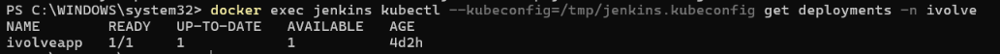
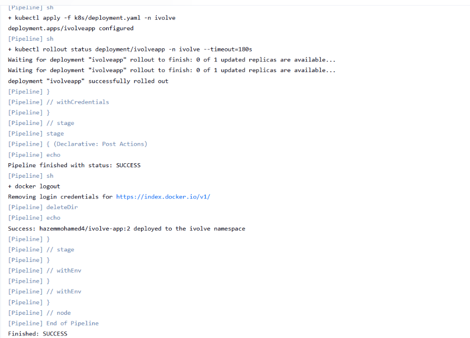
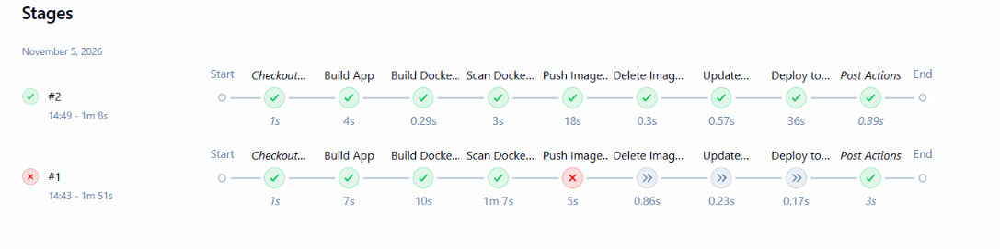
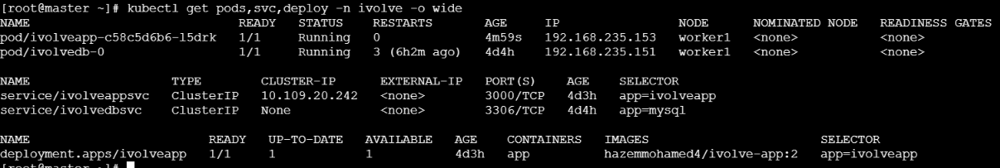

# Lab 21: Jenkins Pipeline for Application Deployment

## Objective

Create a Jenkins pipeline that builds the iVolve Node.js application (Lab 8), packages it as a Docker image, scans it, pushes it to Docker Hub, and deploys it to the Kubernetes cluster (Lab 9) in the `ivolve` namespace (Lab 15).

| #   | Stage                           | What it does                                                 |
| --- | ------------------------------- | ------------------------------------------------------------ |
| 1   | Build App                       | `npm install`                                                |
| 2   | Build Docker Image              | `docker build -t hazemmohamed4/ivolve-app:<BUILD_NUMBER> .`  |
| 3   | Scan Docker Image               | Trivy scan for HIGH and CRITICAL vulnerabilities             |
| 4   | Push Image to DockerHub         | `docker login` with a Jenkins credential, then `docker push` |
| 5   | Delete Image Locally            | `docker rmi`                                                 |
| 6   | Update Image in Deployment File | `sed` replaces the app image tag in `k8s/deployment.yaml`    |
| 7   | Deploy to Kubernetes            | `kubectl apply` and `kubectl rollout status`                 |

Post actions: `always` (print status, `docker logout`, clean workspace), `success`, `failure`.

## Source repository

https://github.com/Hazem-Mohamed8/ivolve-app

```
ivolve-app/
├── Jenkinsfile
├── Dockerfile
├── .dockerignore
├── package.json
├── server.js
├── db.js
├── frontend/
└── k8s/
    ├── deployment.yaml
    └── service.yaml
```

The application and Dockerfile come from Lab 8. `k8s/deployment.yaml` is the `ivolveapp` Deployment from Lab 15 with the Lab 16 changes merged in (resource requests and limits, `maxSurge: 0`, 1 replica), so applying it from Jenkins does not undo the earlier labs.

## How it connects to the previous labs

| Previous lab    | Used here                                                                                            |
| --------------- | ---------------------------------------------------------------------------------------------------- |
| Lab 8 (Docker)  | Application code, Dockerfile, Docker Hub repository `hazemmohamed4/ivolve-app`                       |
| Lab 5 (Trivy)   | Image vulnerability scan stage                                                                       |
| Lab 9 (kubeadm) | The cluster Jenkins deploys to                                                                       |
| Lab 12 to 15    | ConfigMap, Secret, PVC, MySQL StatefulSet and the `ivolveapp` Deployment that the pipeline updates   |
| Lab 19 (RBAC)   | `jenkinssa` ServiceAccount and `ivolvedeployrole` give Jenkins access to the `ivolve` namespace only |

## Environment

| Item                 | Value                                                                       |
| -------------------- | --------------------------------------------------------------------------- |
| Jenkins              | Docker container (`jenkins-tools` image), data in the `jenkins_home` volume |
| Tools inside Jenkins | docker, kubectl, trivy 0.76.1, node 18.20.4, npm 10.7.0, git                |
| Docker access        | Host Docker socket mounted into the Jenkins container                       |
| Cluster              | kubeadm cluster on AWS (1 control plane, 1 worker)                          |

## Setup

### 1. Tools in the Jenkins container

Trivy and Node.js were added to the existing Jenkins container:

```bash
docker exec -u root jenkins sh -c "curl -sfL https://raw.githubusercontent.com/aquasecurity/trivy/main/contrib/install.sh | sh -s -- -b /usr/local/bin"
docker exec -u root jenkins sh -c "curl -fsSL https://nodejs.org/dist/v18.20.4/node-v18.20.4-linux-x64.tar.xz | tar -xJ -C /usr/local --strip-components=1"
docker exec jenkins sh -c "node -v; npm -v; trivy --version; docker ps"
```

### 2. RBAC for Jenkins (Lab 19 extended)

The pipeline runs `kubectl apply` and `kubectl rollout status`, so the Role also needs `get`, `list`, `patch` and `watch` on deployments:

```yaml
rules:
  - apiGroups: ["apps"]
    resources: ["deployments"]
    verbs: ["create", "update", "patch", "get", "list", "watch"]
```

A non-expiring ServiceAccount token was created with a `kubernetes.io/service-account-token` Secret, and used to build `jenkins.kubeconfig`:

```bash
kubectl apply -f - <<'EOF'
apiVersion: v1
kind: Secret
metadata:
  name: jenkinssa-token
  namespace: ivolve
  annotations:
    kubernetes.io/service-account.name: jenkinssa
type: kubernetes.io/service-account-token
EOF

TOKEN=$(kubectl get secret jenkinssa-token -n ivolve -o jsonpath='{.data.token}' | base64 -d)
kubectl config set-cluster k8s --server=https://<MASTER_PUBLIC_IP>:443 --insecure-skip-tls-verify=true --kubeconfig=jenkins.kubeconfig
kubectl config set-credentials jenkinssa --token=$TOKEN --kubeconfig=jenkins.kubeconfig
kubectl config set-context ctx --cluster=k8s --user=jenkinssa --namespace=ivolve --kubeconfig=jenkins.kubeconfig
kubectl config use-context ctx --kubeconfig=jenkins.kubeconfig
```

### 3. Reaching the API server from Jenkins

Jenkins runs on a local machine whose network blocks outgoing connections to ports 22 and 6443 (port 443 works). To work around this, the control plane forwards port 443 to the API server port 6443:

```bash
sudo dnf install -y socat
sudo systemd-run --unit=k8s-443 socat TCP-LISTEN:443,fork,reuseaddr TCP:127.0.0.1:6443
```

The security group allows inbound TCP 443 to the control plane, and the kubeconfig `server:` points to port 443.

Connection test from the Jenkins container:

```bash
docker cp jenkins.kubeconfig jenkins:/tmp/jenkins.kubeconfig
docker exec jenkins kubectl --kubeconfig=/tmp/jenkins.kubeconfig get deployments -n ivolve
```



### 4. Jenkins credentials

| ID               | Kind                   | Content                          |
| ---------------- | ---------------------- | -------------------------------- |
| `dockerhub`      | Username with password | Docker Hub user and access token |
| `k8s-kubeconfig` | Secret file            | `jenkins.kubeconfig`             |

### 5. Pipeline job

New Item → `ivolve-pipeline` → Pipeline → _Pipeline script from SCM_ → Git → `https://github.com/Hazem-Mohamed8/ivolve-app.git` → branch `*/main` → script path `Jenkinsfile`.

## Jenkinsfile

```groovy
pipeline {
    agent any

    environment {
        IMAGE = 'hazemmohamed4/ivolve-app'
        TAG   = "${BUILD_NUMBER}"
    }

    stages {
        stage('Build App') {
            steps {
                sh 'node -v && npm -v'
                sh 'npm install'
            }
        }

        stage('Build Docker Image') {
            steps {
                sh 'docker build -t $IMAGE:$TAG .'
            }
        }

        stage('Scan Docker Image') {
            steps {
                sh 'trivy image --no-progress --severity HIGH,CRITICAL --exit-code 0 $IMAGE:$TAG'
            }
        }

        stage('Push Image to DockerHub') {
            steps {
                withCredentials([usernamePassword(credentialsId: 'dockerhub',
                                                  usernameVariable: 'DH_USER',
                                                  passwordVariable: 'DH_PASS')]) {
                    sh 'echo "$DH_PASS" | docker login -u "$DH_USER" --password-stdin'
                    sh 'docker push $IMAGE:$TAG'
                }
            }
        }

        stage('Delete Image Locally') {
            steps {
                sh 'docker rmi $IMAGE:$TAG'
            }
        }

        stage('Update Image in Deployment File') {
            steps {
                sh 'sed -i "s|image: $IMAGE:.*|image: $IMAGE:$TAG|" k8s/deployment.yaml'
                sh 'grep -n "image:" k8s/deployment.yaml'
            }
        }

        stage('Deploy to Kubernetes') {
            steps {
                withCredentials([file(credentialsId: 'k8s-kubeconfig', variable: 'KUBECONFIG')]) {
                    sh 'kubectl apply -f k8s/deployment.yaml -n ivolve'
                    sh 'kubectl rollout status deployment/ivolveapp -n ivolve --timeout=180s'
                }
            }
        }
    }

    post {
        always {
            echo "Pipeline finished with status: ${currentBuild.currentResult}"
            sh 'docker logout || true'
            deleteDir()
        }
        success {
            echo "Success: ${IMAGE}:${TAG} deployed to the ivolve namespace"
        }
        failure {
            echo 'Failure: check the console output of the failed stage'
        }
    }
}
```

Design notes:

- The `sed` pattern matches only the application image (`hazemmohamed4/ivolve-app:`). The Deployment also has an init container using `mysql:8.0`, which must not change.
- The image tag is the Jenkins build number, so every build produces a unique, traceable image.
- Trivy runs with `--exit-code 0`, so it reports findings without failing the build. Changing it to `1` makes the pipeline fail on HIGH or CRITICAL vulnerabilities.

## Results

### Build #1: failed at the push stage

The first build passed Build, Image and Scan, and failed at **Push Image to DockerHub** with `unauthorized: incorrect username or password`. The Docker Hub credential in Jenkins was wrong. The later stages were skipped, and the `failure` and `always` post actions ran. After fixing the credential (Docker Hub access token), the pipeline was run again.

### Build #2: success

All seven stages passed:

- Image built as `hazemmohamed4/ivolve-app:2`.
- Trivy scan: the application dependencies have 0 vulnerabilities. The base image (`node:18-alpine`, Alpine 3.21.3) has 21 findings (HIGH 19, CRITICAL 2), and the npm that ships inside the Node image has 22 (HIGH 21, CRITICAL 1).
- Login to Docker Hub succeeded, and the image was pushed and then removed locally.
- The Deployment file was updated to `hazemmohamed4/ivolve-app:2`, and `kubectl apply` returned `deployment.apps/ivolveapp configured`.
- `kubectl rollout status` returned `deployment "ivolveapp" successfully rolled out`.




### Verification on the cluster

```bash
kubectl get pods,svc,deploy -n ivolve -o wide
```

The `ivolveapp` pod is `Running` on `worker1`, the Deployment uses `hazemmohamed4/ivolve-app:2`, and the MySQL StatefulSet and both services from earlier labs are untouched.


