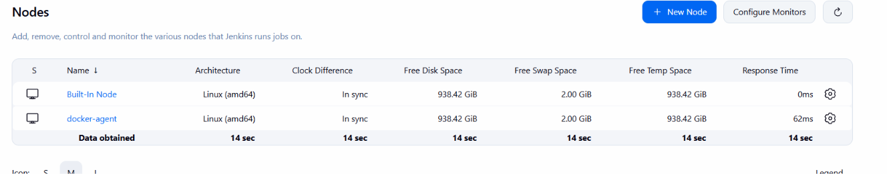
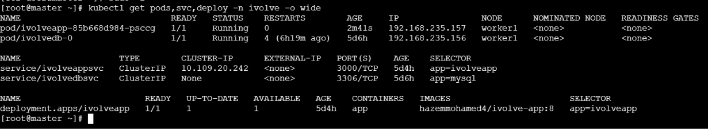

# Lab 22: CI/CD Pipeline with Jenkins Agents and Shared Libraries

## Objective

Refactor the Lab 21 pipeline so that:

1. The reusable logic lives in **Jenkins shared libraries**: `BuildApp`, `BuildImage` and `DeployOnK8s`.
2. The pipeline runs on a **Jenkins agent (slave)** instead of the controller.

| Shared library | Responsibility                                                            |
| -------------- | ------------------------------------------------------------------------- |
| `BuildApp`     | Unit test and build the application                                       |
| `BuildImage`   | Build the Docker image, scan it, push it to Docker Hub, delete it locally |
| `DeployOnK8s`  | Edit the deployment file and deploy to the cluster                        |

The application is the iVolve Node.js app from Lab 8 and the cluster is the one from Lab 9 and Lab 15 (`ivolve` namespace), the same as in Lab 21.

## Repositories

| Repository                                           | Content                                                                                               |
| ---------------------------------------------------- | ----------------------------------------------------------------------------------------------------- |
| https://github.com/Hazem-Mohamed8/jenkins-shared-lib | `vars/BuildApp.groovy`, `vars/BuildImage.groovy`, `vars/DeployOnK8s.groovy`                           |
| https://github.com/Hazem-Mohamed8/ivolve-app         | Application, `Dockerfile`, `k8s/`, `test/`, `Jenkinsfile` (Lab 21) and `Jenkinsfile.lab22` (this lab) |

## 1. Shared libraries

Each file in `vars/` is a global pipeline step named after the file.

### `vars/BuildApp.groovy`

```groovy
def call() {
    echo "BuildApp: installing dependencies, running unit tests"
    sh "node -v && npm -v"
    sh "npm install"
    sh "npm test"
}
```

### `vars/BuildImage.groovy`

```groovy
def call(String imageName, String imageTag, String credentialsId = "dockerhub") {
    echo "BuildImage: ${imageName}:${imageTag}"

    sh "docker build -t ${imageName}:${imageTag} ."

    sh "trivy image --no-progress --severity HIGH,CRITICAL --exit-code 0 ${imageName}:${imageTag}"

    withCredentials([usernamePassword(credentialsId: credentialsId,
                                      usernameVariable: "DH_USER",
                                      passwordVariable: "DH_PASS")]) {
        sh "echo \"\$DH_PASS\" | docker login -u \"\$DH_USER\" --password-stdin"
        sh "docker push ${imageName}:${imageTag}"
    }

    sh "docker rmi ${imageName}:${imageTag}"
}
```

### `vars/DeployOnK8s.groovy`

```groovy
def call(String imageName, String imageTag,
         String namespace = "ivolve",
         String deploymentName = "ivolveapp",
         String deploymentFile = "k8s/deployment.yaml",
         String kubeconfigId = "k8s-kubeconfig") {
    echo "DeployOnK8s: ${imageName}:${imageTag} -> namespace ${namespace}"

    sh "sed -i \"s|image: ${imageName}:.*|image: ${imageName}:${imageTag}|\" ${deploymentFile}"
    sh "grep -n \"image:\" ${deploymentFile}"

    withCredentials([file(credentialsId: kubeconfigId, variable: "KUBECONFIG")]) {
        sh "kubectl apply -f ${deploymentFile} -n ${namespace}"
        sh "kubectl rollout status deployment/${deploymentName} -n ${namespace} --timeout=180s"
    }
}
```

Credentials (`dockerhub` and `k8s-kubeconfig`) are the same Jenkins credentials created in Lab 21. They are resolved on the agent at run time, so nothing secret is stored in the library.

### Registering the library in Jenkins

`Manage Jenkins` → `System` → `Global Trusted Pipeline Libraries` → `Add`:

| Field              | Value                                                      |
| ------------------ | ---------------------------------------------------------- |
| Name               | `ivolve-shared-lib`                                        |
| Default version    | `main`                                                     |
| Retrieval method   | Modern SCM → Git                                           |
| Project repository | `https://github.com/Hazem-Mohamed8/jenkins-shared-lib.git` |

## 2. Unit tests (used by `BuildApp`)

The application had no tests, so `npm test` was added. `package.json` now has:

```json
"scripts": {
  "start": "node server.js",
  "test": "node --test"
}
```

`test/app.test.js` uses the built-in Node.js test runner (no extra dependency) and checks:

1. `db.js` exports the database initializer function.
2. `server.js` has valid JavaScript syntax.
3. `server.js` defines the `/health` and `/ready` endpoints.
4. The frontend page `frontend/index.html` exists.

The tests do not need a database, so they run on any agent. `test` is added to `.dockerignore` so it is not copied into the image.

## 3. Jenkins agent (slave)

The agent is a Docker container on the same Docker network as the Jenkins controller (`jenkins-net`). It connects to the controller over WebSocket, so no extra port is needed.

### Agent image

`agent/Dockerfile` extends `jenkins/inbound-agent` with the tools the pipeline needs: Node.js 18, Docker CLI, kubectl and Trivy.

```dockerfile
FROM jenkins/inbound-agent:latest
USER root

RUN apt-get update \
 && apt-get install -y --no-install-recommends curl ca-certificates xz-utils \
 && rm -rf /var/lib/apt/lists/*

RUN curl -fsSL https://nodejs.org/dist/v18.20.4/node-v18.20.4-linux-x64.tar.xz | tar -xJ -C /usr/local --strip-components=1

RUN curl -fsSL https://download.docker.com/linux/static/stable/x86_64/docker-27.3.1.tgz | tar -xz --strip-components=1 -C /usr/local/bin docker/docker

RUN curl -fsSL -o /usr/local/bin/kubectl "https://dl.k8s.io/release/$(curl -Ls https://dl.k8s.io/release/stable.txt)/bin/linux/amd64/kubectl" \
 && chmod +x /usr/local/bin/kubectl

RUN curl -sfL https://raw.githubusercontent.com/aquasecurity/trivy/main/contrib/install.sh | sh -s -- -b /usr/local/bin
```

```bash
docker build -t ivolve-agent .
```

### Start the agent container

```bash
docker run -d --name jenkins-agent --user root --network jenkins-net \
  -v /var/run/docker.sock:/var/run/docker.sock \
  -e JENKINS_URL=http://jenkins:8080 \
  -e JENKINS_AGENT_NAME=docker-agent \
  -e JENKINS_SECRET=<AGENT_SECRET> \
  -e JENKINS_WEB_SOCKET=true \
  -e JENKINS_AGENT_WORKDIR=/home/jenkins/agent \
  ivolve-agent
```

### Result: agent online

The `docker-agent` node appears next to the Built-In Node in `Manage Jenkins` → `Nodes`:



Tools check on the agent:

```bash
docker exec jenkins-agent sh -c "node -v; docker --version; kubectl version --client; trivy --version"
```

## 4. Pipeline (`Jenkinsfile.lab22`)

```groovy
@Library("ivolve-shared-lib") _

pipeline {
    agent { label "docker-agent" }

    options {
        timeout(time: 20, unit: "MINUTES")
    }

    environment {
        IMAGE = "hazemmohamed4/ivolve-app"
        TAG   = "${BUILD_NUMBER}"
    }

    stages {
        stage("Build App") {
            steps { BuildApp() }
        }

        stage("Build Image") {
            steps { BuildImage(IMAGE, TAG) }
        }

        stage("Deploy to Kubernetes") {
            steps { DeployOnK8s(IMAGE, TAG) }
        }
    }

    post {
        always {
            echo "Pipeline finished with status: ${currentBuild.currentResult} on ${env.NODE_NAME}"
            sh "docker logout || true"
            deleteDir()
        }
        success { echo "Success: ${IMAGE}:${TAG} deployed to the ivolve namespace" }
        failure { echo "Failure: check the console output of the failed stage" }
    }
}
```

## 5. What the console output shows

Deploy stage and post actions:

```bash
Started by user Hazem Mohamed Elshahat saad

Obtained Jenkinsfile.lab22 from git https://github.com/Hazem-Mohamed8/ivolve-app
Loading library ivolve-shared-lib@main
Attempting to resolve main from remote references...
 > git --version # timeout=10
 > git --version # 'git version 2.47.3'
 > git ls-remote -h -- https://github.com/Hazem-Mohamed8/jenkins-shared-lib.git # timeout=10
Found match: refs/heads/main revision c9116035eda67fb886c307d42b86ffe329b7f707
The recommended git tool is: NONE
No credentials specified
 > git rev-parse --resolve-git-dir /var/jenkins_home/workspace/ivolve-pipeline-shared-lib@libs/0b20ddb38409b075f94bb0ce9f36c15e80fa2fd89e0630a382c5b7fd18b782f1/.git # timeout=10
Fetching changes from the remote Git repository
 > git config remote.origin.url https://github.com/Hazem-Mohamed8/jenkins-shared-lib.git # timeout=10
Fetching without tags
Fetching upstream changes from https://github.com/Hazem-Mohamed8/jenkins-shared-lib.git
 > git --version # timeout=10
 > git --version # 'git version 2.47.3'
 > git fetch --no-tags --force --progress -- https://github.com/Hazem-Mohamed8/jenkins-shared-lib.git +refs/heads/*:refs/remotes/origin/* # timeout=10
Checking out Revision c9116035eda67fb886c307d42b86ffe329b7f707 (main)
 > git config core.sparsecheckout # timeout=10
 > git checkout -f c9116035eda67fb886c307d42b86ffe329b7f707 # timeout=10
Commit message: "fix"
 > git rev-list --no-walk c9116035eda67fb886c307d42b86ffe329b7f707 # timeout=10
[Pipeline] Start of Pipeline
[Pipeline] node
Running on docker-agent
 in /home/jenkins/agent/workspace/ivolve-pipeline-shared-lib
[Pipeline] {
[Pipeline] stage
[Pipeline] { (Declarative: Checkout SCM)
[Pipeline] checkout
Selected Git installation does not exist. Using Default
The recommended git tool is: NONE
No credentials specified
Cloning the remote Git repository
Cloning repository https://github.com/Hazem-Mohamed8/ivolve-app
 > git init /home/jenkins/agent/workspace/ivolve-pipeline-shared-lib # timeout=10
Fetching upstream changes from https://github.com/Hazem-Mohamed8/ivolve-app
 > git --version # timeout=10
 > git --version # 'git version 2.47.3'
 > git fetch --tags --force --progress -- https://github.com/Hazem-Mohamed8/ivolve-app +refs/heads/*:refs/remotes/origin/* # timeout=10
Avoid second fetch
Checking out Revision 383b2da5e7d0ef19d7be53b0e52039ab6742c7af (refs/remotes/origin/main)
Commit message: "lab 22"
 > git config remote.origin.url https://github.com/Hazem-Mohamed8/ivolve-app # timeout=10
 > git config --add remote.origin.fetch +refs/heads/*:refs/remotes/origin/* # timeout=10
 > git rev-parse refs/remotes/origin/main^{commit} # timeout=10
 > git config core.sparsecheckout # timeout=10
 > git checkout -f 383b2da5e7d0ef19d7be53b0e52039ab6742c7af # timeout=10
 > git rev-list --no-walk 383b2da5e7d0ef19d7be53b0e52039ab6742c7af # timeout=10
[Pipeline] }
[Pipeline] // stage
[Pipeline] withEnv
[Pipeline] {
[Pipeline] withEnv
[Pipeline] {
[Pipeline] timeout
Timeout set to expire in 20 min
[Pipeline] {
[Pipeline] stage
[Pipeline] { (Build App)
[Pipeline] echo
BuildApp: installing dependencies, running unit tests
[Pipeline] sh
+ node -v
v18.20.4
+ npm -v
10.7.0
[Pipeline] sh
+ npm install


added 84 packages, and audited 85 packages in 3s

23 packages are looking for funding
  run `npm fund` for details

found 0 vulnerabilities
[Pipeline] sh

+ npm test

> ecommerce-ivolve@1.0.0 test
> node --test

TAP version 13
# Subtest: db.js exports the database initializer function
ok 1 - db.js exports the database initializer function
  ---
  duration_ms: 81.277839
  ...
# Subtest: server.js has valid JavaScript syntax
ok 2 - server.js has valid JavaScript syntax
  ---
  duration_ms: 29.843369
  ...
# Subtest: server.js defines the /health and /ready endpoints
ok 3 - server.js defines the /health and /ready endpoints
  ---
  duration_ms: 0.421947
  ...
# Subtest: frontend page exists
ok 4 - frontend page exists
  ---
  duration_ms: 0.228598
  ...
1..4
# tests 4
# suites 0
# pass 4
# fail 0
# cancelled 0
# skipped 0
# todo 0
# duration_ms 184.498595
[Pipeline] }
[Pipeline] // stage
[Pipeline] stage
[Pipeline] { (Build Image)
[Pipeline] echo
BuildImage: hazemmohamed4/ivolve-app:8
[Pipeline] sh
+ docker build -t hazemmohamed4/ivolve-app:8 .
DEPRECATED: The legacy builder is deprecated and will be removed in a future release.
            Install the buildx component to build images with BuildKit:
            https://docs.docker.com/go/buildx/

Sending build context to Docker daemon  152.6kB

Step 1/7 : FROM node:18-alpine
 ---> ee77c6cd7c18
Step 2/7 : WORKDIR /app
 ---> Using cache
 ---> 0f086914216b
Step 3/7 : COPY package.json ./
 ---> Using cache
 ---> 418776e2644c
Step 4/7 : RUN npm install
 ---> Using cache
 ---> df5447059b33
Step 5/7 : COPY . .
 ---> Using cache
 ---> 57c9da156cbd
Step 6/7 : EXPOSE 3000
 ---> Using cache
 ---> dfe145e64d38
Step 7/7 : CMD ["node", "server.js"]
 ---> Using cache
 ---> b541a12badd6
Successfully built b541a12badd6
Successfully tagged hazemmohamed4/ivolve-app:8
[Pipeline] sh

+ trivy image --cache-dir /opt/trivy-cache --no-progress --severity HIGH,CRITICAL --exit-code 0 hazemmohamed4/ivolve-app:8
2026-11-06T14:28:37Z	INFO	[vuln] Vulnerability scanning is enabled
2026-11-06T14:28:37Z	INFO	[secret] Secret scanning is enabled
2026-11-06T14:28:37Z	INFO	[secret] If your scanning is slow, please try '--scanners vuln' to disable secret scanning
2026-11-06T14:28:37Z	INFO	[secret] Please see https://trivy.dev/docs/v0.69/guide/scanner/secret#recommendation for faster secret detection

2026-11-06T14:28:40Z	INFO	Detected OS	family="alpine" version="3.21.3"
2026-11-06T14:28:40Z	INFO	[alpine] Detecting vulnerabilities...	os_version="3.21" repository="3.21" pkg_num=17
2026-11-06T14:28:40Z	INFO	Number of language-specific files	num=1
2026-11-06T14:28:40Z	INFO	[node-pkg] Detecting vulnerabilities...
2026-11-06T14:28:40Z	WARN	Using severities from other vendors for some vulnerabilities. Read https://trivy.dev/docs/v0.69/guide/scanner/vulnerability#severity-selection for details.
2026-11-06T14:28:40Z	INFO	Table result includes only package filenames. Use '--format json' option to get the full path to the package file.

For OSS Maintainers: VEX Notice
--------------------------------
If you're an OSS maintainer and Trivy has detected vulnerabilities in your project that you believe are not actually exploitable, consider issuing a VEX (Vulnerability Exploitability eXchange) statement.
VEX allows you to communicate the actual status of vulnerabilities in your project, improving security transparency and reducing false positives for your users.
Learn more and start using VEX: https://trivy.dev/docs/v0.69/guide/supply-chain/vex/repo#publishing-vex-documents

To disable this notice, set the TRIVY_DISABLE_VEX_NOTICE environment variable.


hazemmohamed4/ivolve-app:8 (alpine 3.21.3)
==========================================
Total: 22 (HIGH: 20, CRITICAL: 2)

Node.js (node-pkg)
==================
Total: 22 (HIGH: 21, CRITICAL: 1)

📣 Notices:
  - Version 0.76.2 of Trivy is now available, current version is 0.69.3

To suppress version checks, run Trivy scans with the --skip-version-check flag

[Pipeline] withCredentials
Masking supported pattern matches of $DOCKER_USER or $DOCKER_PASS
[Pipeline] {
[Pipeline] sh
+ echo ****
+ docker login -u **** --password-stdin

WARNING! Your password will be stored unencrypted in /root/.docker/config.json.
Configure a credential helper to remove this warning. See
https://docs.docker.com/engine/reference/commandline/login/#credential-stores

Login Succeeded
[Pipeline] sh
Warning: A secret was passed to "sh" using Groovy String interpolation, which is insecure.
		 Affected argument(s) used the following variable(s): [DOCKER_USER]
		 See https://jenkins.io/redirect/groovy-string-interpolation for details.
+ docker push ****/ivolve-app:8
The push refers to repository [docker.io/****/ivolve-app]

c7a3354eba9a: Preparing
5812334a273e: Preparing
300f38bf8888: Preparing
01c69710e313: Preparing
82140d9a70a7: Preparing
f3b40b0cdb1c: Preparing
0b1f26057bd0: Preparing
08000c18d16d: Preparing
0b1f26057bd0: Waiting
f3b40b0cdb1c: Waiting
08000c18d16d: Waiting

01c69710e313: Layer already exists
82140d9a70a7: Layer already exists

0b1f26057bd0: Layer already exists
f3b40b0cdb1c: Layer already exists
08000c18d16d: Layer already exists

300f38bf8888: Pushed

c7a3354eba9a: Pushed

5812334a273e: Pushed

8: digest: sha256:32a85ee798b1e00fb24731eedb68142b440df8cbc8944add6255923470533def size: 1991
[Pipeline] }
[Pipeline] // withCredentials
[Pipeline] sh

+ docker rmi hazemmohamed4/ivolve-app:8
Untagged: hazemmohamed4/ivolve-app:8
[Pipeline] }
[Pipeline] // stage
[Pipeline] stage
[Pipeline] { (Deploy to Kubernetes)
[Pipeline] echo
DeployOnK8s: hazemmohamed4/ivolve-app:8 -> namespace ivolve
[Pipeline] sh
+ sed -i s|image: hazemmohamed4/ivolve-app:.*|image: hazemmohamed4/ivolve-app:8| k8s/deployment.yaml
[Pipeline] sh
+ grep -n image: k8s/deployment.yaml
32:          image: mysql:8.0
58:          image: hazemmohamed4/ivolve-app:8
[Pipeline] withCredentials
Masking supported pattern matches of $KUBECONFIG
[Pipeline] {
[Pipeline] sh

+ kubectl apply -f k8s/deployment.yaml -n ivolve

deployment.apps/ivolveapp configured
[Pipeline] sh
+ kubectl rollout status deployment/ivolveapp -n ivolve --timeout=180s

Waiting for deployment "ivolveapp" rollout to finish: 0 of 1 updated replicas are available...

Waiting for deployment "ivolveapp" rollout to finish: 0 of 1 updated replicas are available...

deployment "ivolveapp" successfully rolled out
[Pipeline] }
[Pipeline] // withCredentials
[Pipeline] }
[Pipeline] // stage
[Pipeline] stage
[Pipeline] { (Declarative: Post Actions)
[Pipeline] echo
Pipeline finished with status: SUCCESS on docker-agent
[Pipeline] sh
+ docker logout
Removing login credentials for https://index.docker.io/v1/
[Pipeline] deleteDir
[Pipeline] echo

Success: hazemmohamed4/ivolve-app:8 deployed to the ivolve namespace
[Pipeline] }
[Pipeline] // stage
[Pipeline] }
[Pipeline] // timeout
[Pipeline] }
[Pipeline] // withEnv
[Pipeline] }
[Pipeline] // withEnv
[Pipeline] }
[Pipeline] // node
[Pipeline] End of Pipeline
Finished: SUCCESS
```

Cluster state after the deployment:

```bash
kubectl get pods,svc,deploy -n ivolve -o wide
```


