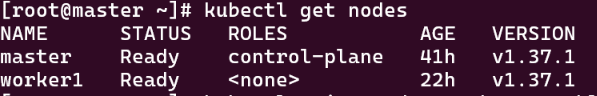
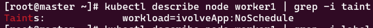
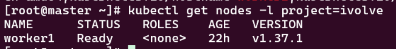
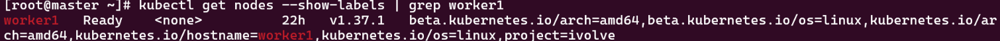

# Lab 10: Node Isolation Using Taints and Labels in Kubernetes

```bash
kubectl get nodes
```



## Steps

**1. Taint the worker node**

Key `workload`, value `ivolveApp`, effect `NoSchedule`. Pods without a matching toleration will not be scheduled on this node.

```bash
kubectl taint nodes worker1 workload=ivolveApp:NoSchedule
```

**2. Label the worker node**

```bash
kubectl label nodes worker1 project=ivolve
```

## Verification

Check the taint:

```bash
kubectl describe node worker1 | grep -i taint
```



Check the label:

```bash
kubectl get nodes --show-labels
```




