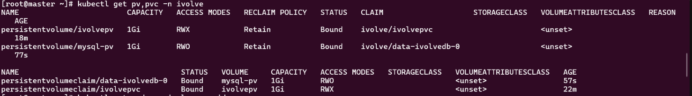
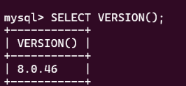
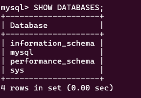
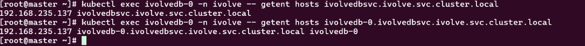

# Lab 14: StatefulSet with Headless Service

## Steps

```bash
kubectl apply -f manifests/mysql-pv.yaml
kubectl apply -f manifests/ivolvedbsvc.yaml
kubectl apply -f manifests/ivolvedb-statefulset.yaml
```

## Verification

### 1. PV and PVC are bound

`ivolvepv` is bound to `ivolvepvc`, and the StatefulSet's claim `data-ivolvedb-0` is bound to `mysql-pv`.

```bash
kubectl get pv,pvc -n ivolve
```



### 2. The StatefulSet pod is running

```bash
kubectl get pods -n ivolve
```


### 3. The database is operational (MySQL client)

```bash
kubectl exec -it ivolvedb-0 -n ivolve -- mysql -uroot -p
```

```sql
SELECT VERSION();
SHOW DATABASES;
```





### 4. DNS resolution of the MySQL pod

Both the headless service name and the pod name resolve to the same pod IP (`192.168.235.137`), not to a service ClusterIP.

```bash
kubectl exec ivolvedb-0 -n ivolve -- getent hosts ivolvedbsvc.ivolve.svc.cluster.local
kubectl exec ivolvedb-0 -n ivolve -- getent hosts ivolvedb-0.ivolvedbsvc.ivolve.svc.cluster.local
```


