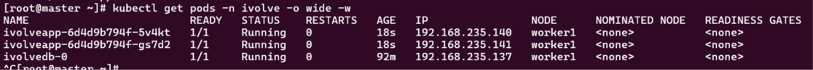
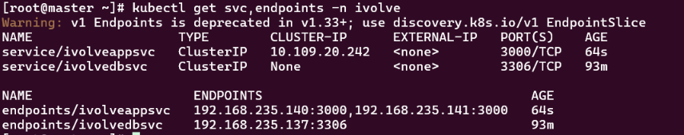
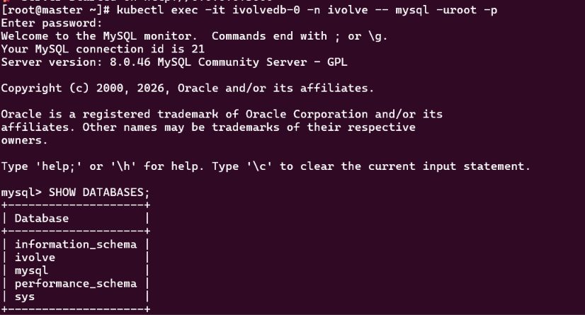

# Lab 15: Node.js Application Deployment with ClusterIP Service

## Steps

```bash
kubectl apply -f manifests/ivolveapp-deployment.yaml
kubectl apply -f manifests/ivolveappsvc.yaml
```

## Verification

### 1. Both application pods are running

Both pods run on `worker1`, next to `ivolvedb-0`.

```bash
kubectl get pods -n ivolve -o wide
```



### 2. The service has both pods as endpoints

`ivolveappsvc` is a ClusterIP service, and `ivolvedbsvc` is headless (`CLUSTER-IP: None`).

```bash
kubectl get svc,endpoints -n ivolve
```




### 3. The init container created the `ivolve` database

The database list now includes `ivolve`, which was not there before the app was deployed.

```bash
kubectl exec -it ivolvedb-0 -n ivolve -- mysql -uroot -p
```

```sql
SHOW DATABASES;
```



### 4. Application user privileges

```sql
SHOW GRANTS FOR 'ivolveuser'@'%';
```

### 5. Application logs show a successful MySQL connection

```bash
kubectl logs deploy/ivolveapp -n ivolve
```
