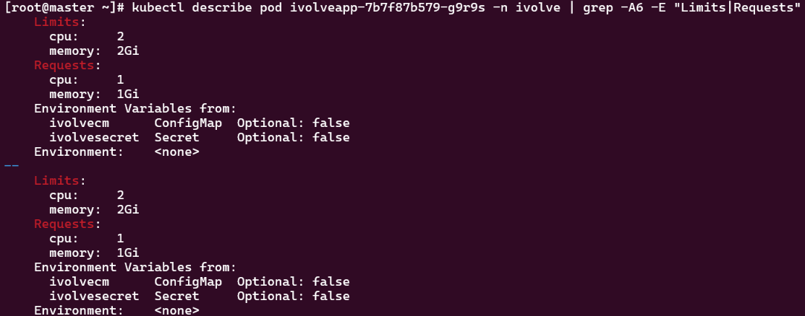
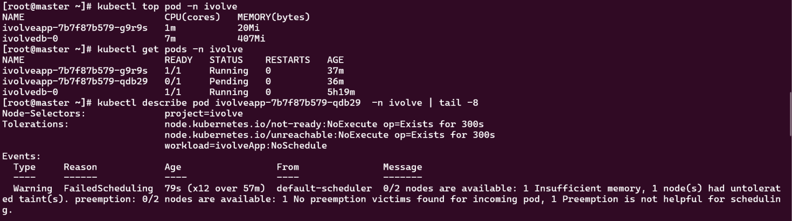
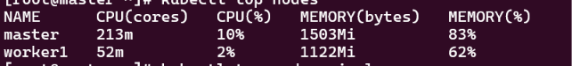
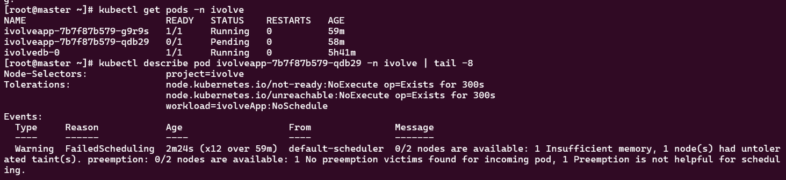
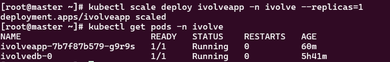

# Lab 16: Pod Resource Management with CPU and Memory Requests and Limits

Goal: update the existing `ivolveapp` Deployment (namespace `ivolve`) with resource requests and limits,
verify them with `kubectl describe pod`, and monitor real-time usage with `kubectl top pod`.

| | CPU | Memory |
|---|---|---|
| Requests | 1 | 1Gi |
| Limits | 2 | 2Gi |

## 1. Update the Deployment

The ResourceQuota from Lab 11 allows only 3 pods in the namespace (MySQL + 2 application pods).
The default rolling update creates an extra pod during the update, which the quota would reject.
So the update strategy was changed first:

```bash
kubectl patch deployment ivolveapp -n ivolve --type merge \
  -p '{"spec":{"strategy":{"type":"RollingUpdate","rollingUpdate":{"maxSurge":0,"maxUnavailable":1}}}}'
```

Then the resource requests and limits were added:

```bash
kubectl set resources deployment ivolveapp -n ivolve \
  --requests=cpu=1,memory=1Gi --limits=cpu=2,memory=2Gi

kubectl get pods -n ivolve
```

The same `resources` block is equivalent to this in the Deployment manifest (container `app`):

```yaml
        resources:
          requests:
            cpu: "1"
            memory: 1Gi
          limits:
            cpu: "2"
            memory: 2Gi
```


## 2. Verify requests and limits

```bash
kubectl describe pod <pod-name> -n ivolve | grep -A6 -E "Limits|Requests"
```

The pod shows `cpu: 2` and `memory: 2Gi` as limits, and `cpu: 1` and `memory: 1Gi` as requests.



The output has two blocks because `kubectl set resources` applied the values to every container in the pod,
including the init container (the MySQL client from Lab 15). This does not double the reservation:
the scheduler uses the larger of the highest init container request and the sum of the app container requests.

## 3. Install metrics-server

`kubectl top` needs the metrics server. Two changes were needed on this kubeadm cluster:

- `--kubelet-insecure-tls`, because the kubelet certificates are self-signed.
- A toleration for the control-plane taint. The worker has the `workload=ivolveApp:NoSchedule` taint (Lab 10)
  and the master has `node-role.kubernetes.io/control-plane:NoSchedule`, so without it the pods stayed
  `Pending` with `2 node(s) had untolerated taint(s)`.

```bash
kubectl apply -f https://github.com/kubernetes-sigs/metrics-server/releases/latest/download/components.yaml

kubectl patch deployment metrics-server -n kube-system --type='json' \
  -p='[{"op":"add","path":"/spec/template/spec/containers/0/args/-","value":"--kubelet-insecure-tls"}]'

kubectl patch deployment metrics-server -n kube-system --type='json' \
  -p='[{"op":"add","path":"/spec/template/spec/tolerations/-","value":{"key":"node-role.kubernetes.io/control-plane","operator":"Exists","effect":"NoSchedule"}}]'

kubectl get pods -n kube-system | grep metrics-server
```

The metrics-server pod is `1/1 Running`.


## 4. Monitor real-time usage

```bash
kubectl top nodes
kubectl top pod -n ivolve
```

Output:

```
NAME      CPU(cores)   CPU(%)   MEMORY(bytes)   MEMORY(%)
master    213m         10%      1503Mi          83%
worker1   52m          2%       1122Mi          62%

NAME                         CPU(cores)   MEMORY(bytes)
ivolveapp-7b7f87b579-g9r9s   1m           20Mi
ivolvedb-0                   7m           407Mi
```




## Notes

- With these requests (1 CPU and 1Gi per replica), the worker node could only fit one application replica.
  The second replica stayed `Pending` with `0/2 nodes are available: 1 Insufficient memory, 1 node(s) had untolerated taint(s)`
  (the other node is the control plane, which the pod does not tolerate).
  The requests and limits were applied as required, and the Deployment was scaled to one replica so that
  the pods are stable:

  ```bash
  kubectl scale deploy ivolveapp -n ivolve --replicas=1
  ```

  
  

- Requests are used by the scheduler to place a pod: a pod is scheduled only on a node with enough
  unreserved CPU and memory. Limits are enforced at runtime: CPU above the limit is throttled, and a
  container that exceeds its memory limit is OOM-killed.
- The actual usage (about 20Mi memory and 1m CPU for the application pod) is far below the requests.
  The requests reserve capacity on the node regardless of real usage.

## Result

The `ivolveapp` Deployment has the requested CPU and memory requests and limits, and `kubectl top pod`
shows live usage through the metrics server.
