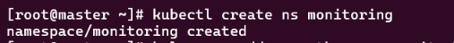
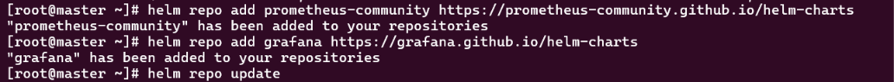
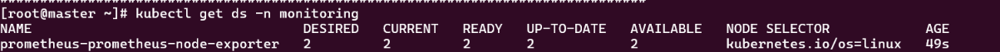
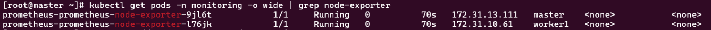
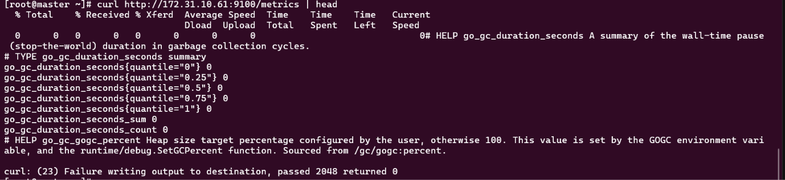
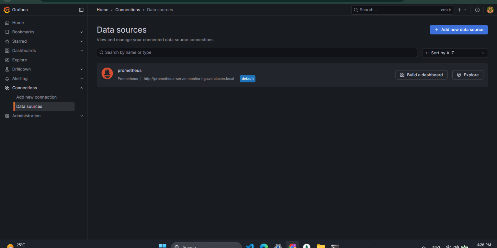
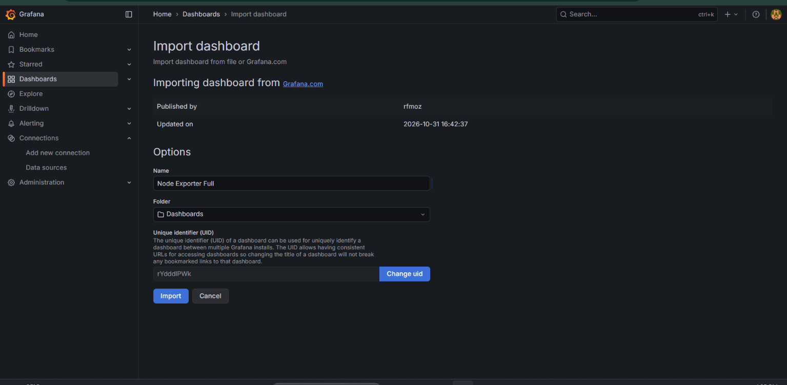
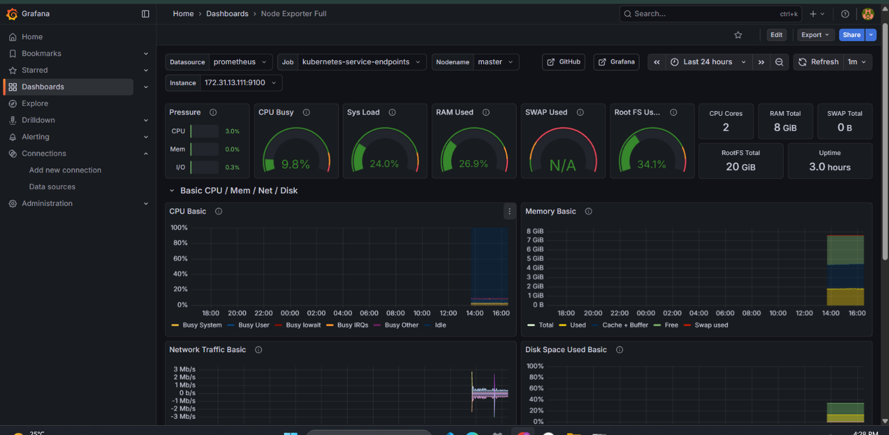
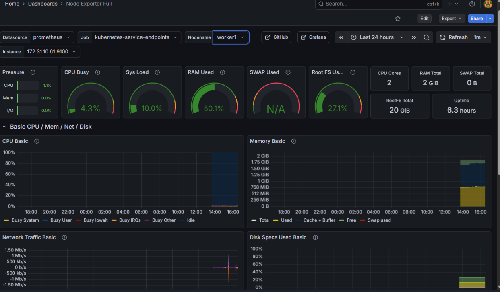
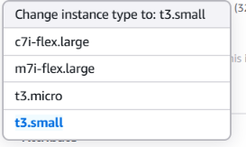

# Lab 18: Node-Wide Pod Management with DaemonSet (Monitoring Stack)

## Objective

Deploy a monitoring stack in a dedicated `monitoring` namespace: Prometheus, Alertmanager, Grafana and a Prometheus node-exporter DaemonSet. Validate that one node-exporter pod runs on every node, that metrics are exposed on `<node_IP>:9100/metrics`, that Prometheus scrapes them, and that Grafana shows a node dashboard.

## Steps

### 1. Install Helm

```bash
curl -fsSL -o get_helm.sh https://raw.githubusercontent.com/helm/helm/main/scripts/get-helm-3
chmod 700 get_helm.sh
./get_helm.sh
helm version
```

### 2. Create the namespace and add the chart repositories

```bash
kubectl create ns monitoring
helm repo add prometheus-community https://prometheus-community.github.io/helm-charts
helm repo add grafana https://grafana.github.io/helm-charts
helm repo update
```





### 3. Prepare the values files

Both nodes are tainted and the cluster has no StorageClass, so the values files:

- disable persistence for Prometheus, Alertmanager and Grafana
- add a toleration for the control-plane taint
- pin the pods to the master with a node selector
- disable the Pushgateway (not needed for this lab)

`prom-values.yaml`:

```yaml
server:
  persistentVolume:
    enabled: false
  tolerations:
    - key: node-role.kubernetes.io/control-plane
      operator: Exists
      effect: NoSchedule
  nodeSelector:
    kubernetes.io/hostname: master
alertmanager:
  enabled: true
  persistence:
    enabled: false
  tolerations:
    - key: node-role.kubernetes.io/control-plane
      operator: Exists
      effect: NoSchedule
  nodeSelector:
    kubernetes.io/hostname: master
kube-state-metrics:
  tolerations:
    - key: node-role.kubernetes.io/control-plane
      operator: Exists
      effect: NoSchedule
  nodeSelector:
    kubernetes.io/hostname: master
prometheus-pushgateway:
  enabled: false
prometheus-node-exporter:
  enabled: true
```

`grafana-values.yaml`:

```yaml
service:
  type: NodePort
adminPassword: admin123
persistence:
  enabled: false
tolerations:
  - key: node-role.kubernetes.io/control-plane
    operator: Exists
    effect: NoSchedule
nodeSelector:
  kubernetes.io/hostname: master
```

The admin password is a lab value only. Use a Secret in a real environment.

### 4. Install Prometheus (with Alertmanager and node-exporter) and Grafana

```bash
helm install prometheus prometheus-community/prometheus -n monitoring -f prom-values.yaml
helm install grafana grafana/grafana -n monitoring -f grafana-values.yaml
kubectl get pods -n monitoring -o wide
```

Result: every pod reached `Running`.

```
grafana-88658659f-4t8lq                          1/1   Running   master
prometheus-alertmanager-0                        2/2   Running   master
prometheus-kube-state-metrics-7df86fc7f5-lq94q   1/1   Running   master
prometheus-prometheus-node-exporter-flmrb        1/1   Running   worker1
prometheus-prometheus-node-exporter-m6kqm        1/1   Running   master
prometheus-server-54cc7c4cd8-424hn               2/2   Running   master
```

### 5. Validate the node-exporter DaemonSet

The chart runs node-exporter as a DaemonSet. Its default tolerations let it schedule on both tainted nodes.

```bash
kubectl get ds -n monitoring
kubectl get pods -n monitoring -o wide | grep node-exporter
```





### 6. Confirm the metrics endpoint

```bash
curl http://172.31.10.61:9100/metrics | head
```



The `curl: (23) Failure writing output` message is harmless. It appears only because `head` closes the pipe after a few lines.

### 7. Confirm that Prometheus scrapes node-exporter

```bash
kubectl port-forward -n monitoring svc/prometheus-server 9090:80 --address 0.0.0.0 &
curl -s localhost:9090/api/v1/targets | grep -o '"health":"[a-z]*"' | sort | uniq -c
curl -s localhost:9090/api/v1/targets | grep -o '"scrapeUrl":"[^"]*9100[^"]*"'
```

Result:

```
12 "health":"up"
 1 "health":"down"

"scrapeUrl":"http://172.31.10.61:9100/metrics"
"scrapeUrl":"http://172.31.13.111:9100/metrics"
```

Both node-exporter endpoints (worker1 and master) are scraped and healthy. The single `down` target is `192.168.219.77:9094`, the Alertmanager cluster (gossip) port picked up by the `kubernetes-service-endpoints` job. That port does not serve `/metrics`, so the failure is expected and does not affect the lab.

### 8. Configure Grafana

Grafana is exposed as a NodePort (`30869`). To reach it without opening the port in the security group, an SSH tunnel from the local machine was used:

```bash
ssh -i k8s-lab-key.pem -L 3000:localhost:30869 ec2-user@<node-public-IP>
```

Then `http://localhost:3000`, login `admin` / `admin123`.

The Grafana chart provisions the Prometheus data source automatically, pointing to `http://prometheus-server.monitoring.svc.cluster.local` (set as default).



Dashboard imported from grafana.com: **Node Exporter Full** (ID `1860`).



Dashboard for the master node (`172.31.13.111:9100`):



Dashboard for the worker node (`172.31.10.61:9100`):



Both nodes appear in the Instance selector with live CPU, memory, load, network and disk panels, which shows the full path working: node-exporter exposes the metrics, Prometheus scrapes and stores them, Grafana renders them.

## Troubleshooting notes

**1. Pods stuck in Pending (taints and PVCs).** The first install used default values. Prometheus, Alertmanager, Grafana and kube-state-metrics stayed `Pending` with `0/2 nodes are available: 2 node(s) had untolerated taint(s)`, because both nodes are tainted and these pods had no tolerations. Only node-exporter ran, since its chart tolerates all taints. The Prometheus server and Alertmanager PVCs were also `Pending` because the cluster has no StorageClass.

**2. `helm upgrade` failed.**

```
cannot patch "prometheus-alertmanager" with kind StatefulSet: ... spec.volumeClaimTemplates: Invalid value: null: field is immutable
```

A StatefulSet's volume claim templates cannot change after creation. The fix was `helm uninstall`, deleting the leftover PVCs, and reinstalling with the values files above.

**3. Master out of memory.** The master was a `t3.small` (2 GB RAM). The control plane alone used about 1.3 GB, so with the monitoring stack on top the API server became unresponsive (`TLS handshake timeout`, dropped SSH sessions) and control-plane components restarted repeatedly.

The fix was to stop the instance and change its type to `m7i-flex.large` (2 vCPU, 8 GB). The private IP stayed the same, so the cluster and worker recovered without any change. After the resize about 6 GB of memory was available, and all nodes were `Ready`.



**4. Running `kubectl` on the worker.** `kubectl` returned `localhost:8080 connection refused` on `worker1`, which has no kubeconfig. All `kubectl` and `helm` commands run on the master.

**5. Grafana not reachable from the browser.** `curl localhost:30869` on the node returned the `/login` redirect, so Grafana itself was healthy. The NodePort was not open in the security group, so an SSH tunnel was used.

## Cleanup

```bash
helm uninstall prometheus -n monitoring
helm uninstall grafana -n monitoring
kubectl delete ns monitoring
```
