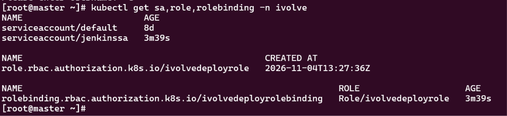

# Lab 19: Securing Kubernetes with RBAC and Service Accounts

## Objective

Create a service account for Jenkins in the `ivolve` namespace and give it only the permissions it needs: create and update Deployments in that namespace, and nothing else.

### `serviceaccount.yaml`: the identity

Creates the service account that Jenkins will use to authenticate to the cluster.

```yaml
apiVersion: v1
kind: ServiceAccount
metadata:
  name: jenkinssa
  namespace: ivolve
```

### `role.yaml`: the permissions

```yaml
apiVersion: rbac.authorization.k8s.io/v1
kind: Role
metadata:
  name: ivolvedeployrole
  namespace: ivolve
rules:
  - apiGroups: ["apps"]
    resources: ["deployments"]
    verbs: ["create", "update", "patch", "get", "list"]
```

### `rolebinding.yaml`: the link

Attaches the Role to the service account. Without this binding, the role and the service account have no relation to each other.

```yaml
apiVersion: rbac.authorization.k8s.io/v1
kind: RoleBinding
metadata:
  name: ivolvedeployrolebinding
  namespace: ivolve
subjects:
  - kind: ServiceAccount
    name: jenkinssa
    namespace: ivolve
roleRef:
  kind: Role
  name: ivolvedeployrole
  apiGroup: rbac.authorization.k8s.io
```

## Steps

### 1. Create the service account

```bash
kubectl apply -f serviceaccount.yaml
```

### 2. Create the role

```bash
kubectl apply -f role.yaml
```

### 3. Bind the role to the service account

```bash
kubectl apply -f rolebinding.yaml
kubectl get sa,role,rolebinding -n ivolve
```



### 4. Create a token for the service account

```bash
kubectl create token jenkinssa -n ivolve
```

### 5. Validate the permissions

```bash

kubectl auth can-i create deployments -n ivolve --as=ystem:serviceaccount:ivolve:jenkinssa
kubectl auth can-i update deployments -n ivolve --as=ystem:serviceaccount:ivolve:jenkinssa
kubectl auth can-i delete deployments -n ivolve --as=ystem:serviceaccount:ivolve:jenkinssa
kubectl auth can-i create deployments -n default --as=ystem:serviceaccount:ivolve:jenkinssa
```

## Cleanup

```bash
kubectl delete -f rolebinding.yaml
kubectl delete -f role.yaml
kubectl delete -f serviceaccount.yaml
```
